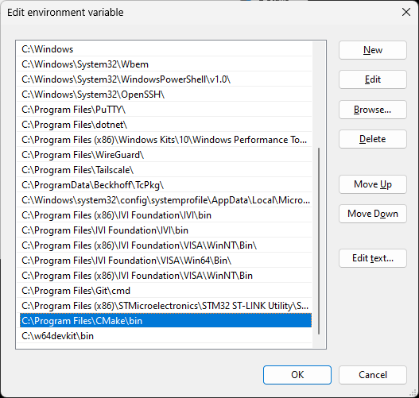

# README #

This repository contain compiler and cmake tools to compile testdrive_v3 and the required dependency for it.
Installer is located at the 'installer' folder.
The 'portable' folder contains files and folder of the installed tools, copied directly from test PC after installation.
Make sure the system path setting has the path to the required tools, cmake, make, gcc etc...

testdrive_v3 requires dll files from Winpcap installation. Installation of the dependency can be found in the 'dependency' folder.

### Who do I talk to? ###

* Firmware team